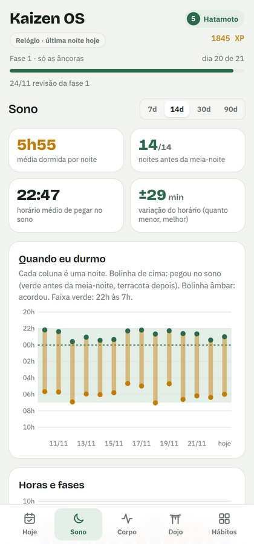
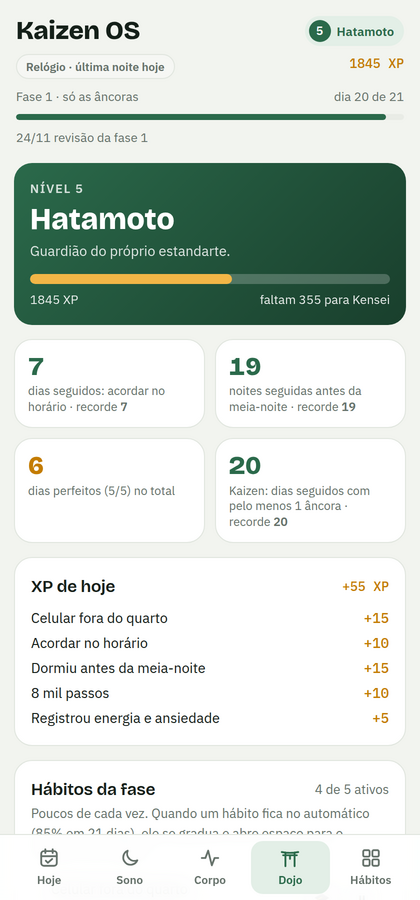

# Kaizen OS

**改善 · um pouco todo dia.** Um monitor pessoal de hábitos e saúde: privado, bonito, instalável no celular e feito para você **não desistir de preencher**.

<p>
  
  
  
</p>

<sub>Capturas com dados de demonstração.</sub>

## A ideia

A maioria dos apps de hábito vira um checklist de 15 itens que você abandona em duas semanas. O Kaizen OS faz o contrário:

- **Âncoras:** no máximo **5 hábitos ativos**, pequenos e concretos ("20 minutos já contam").
- **Graduação:** quando um hábito fica no automático (85% em 21 dias), ele **gradua** 🎓, sai do check-in diário e abre espaço para o próximo mini-hábito. O histórico fica.
- **Fases:** blocos de 2 a 3 semanas. No fim de cada uma, você revê o que graduar e o que entra.
- **Kaizen:** o mapa dos últimos 21 dias na tela inicial. Um pouco todo dia é o superpoder.
- **Recaída é dado, não sentença:** falhar um dia nunca tira XP, recorde nem conquista.

## O que tem

- **Hoje:** check-in Sim/Não, anel de progresso, a noite de sono, passos, treinos, energia, ansiedade e uma nota.
- **Sono:** quando você dorme e acorda, noite a noite, regularidade e fases (profundo, REM, leve).
- **Corpo:** passos, treinos e frequência cardíaca.
- **Dojo:** XP, níveis (de Rōnin a Mestre dos Cinco Anéis), sequências, conquistas com som, vibração e confete, e a gestão dos hábitos.
- **Relógio/pulseira (Android, opcional):** qualquer app que escreva no **Health Connect** (Mi Fitness, Samsung Health, Fitbit, Garmin, Zepp…) envia sono, passos, treinos e SpO₂ pelo app **HC Webhook**.
- **PWA:** instala como app no Android, iPhone e computador; abre offline com o último estado.
- **Linha de comando** para você ou um agente de IA registrar pelo chat.

## Como montar (com uma IA guiando)

1. Baixe este repositório (**Code → Download ZIP**) ou clone.
2. Envie o arquivo **[`GUIA-PARA-IA.md`](GUIA-PARA-IA.md)** ao seu assistente de IA (Claude, ChatGPT, Gemini, Claude Code, Cursor…). Se ele acessa a internet, basta colar o link deste repositório.
3. Diga: *"Leia o GUIA-PARA-IA.md e me ajude a montar o meu Kaizen OS, um passo de cada vez."*

A IA pergunta seu sistema, celular, relógio e quais hábitos você quer, e conduz cada etapa com um teste de verificação. Tempo estimado: 30 a 60 minutos.

## Requisitos

- Um computador que fique ligado (PC, notebook, mini-PC, Raspberry Pi ou VPS) com **Python 3.9+**. Sem dependências externas; banco SQLite local.
- **[Tailscale](https://tailscale.com)** (grátis) no computador e no celular, para acessar com HTTPS sem expor nada na internet.
- Opcional: relógio/pulseira no Android + [HC Webhook](https://github.com/mcnaveen/health-connect-webhook).

## Início rápido (para quem já sabe)

```bash
cp app/seed.example.json app/seed.json          # edite: nome, hábitos, fase
export ANCORAS_TOKEN="$(python3 -c 'import secrets;print(secrets.token_urlsafe(32))')"
python3 app/app.py serve --host 127.0.0.1 --port 8787
# abra http://localhost:8787/?k=$ANCORAS_TOKEN uma vez (grava um cookie de 1 ano)
```

Serviço permanente: `deploy/kaizen-os.service` (systemd) ou `deploy/docker-compose.yml`.

## Estrutura

```
GUIA-PARA-IA.md        roteiro para a IA conduzir a instalação
app/app.py             servidor HTTP + CLI (hábitos, fases, check-ins, export CSV)
app/saude.py           ingestão do Health Connect e resumos diários
app/index.html         interface (PWA responsiva, claro/escuro)
app/static/jogo.js     XP, níveis, conquistas, sons (Web Audio) e confete
app/seed.example.json  modelo de hábitos e fase
deploy/                systemd e Docker
```

## Privacidade

Seus dados ficam só no seu computador (`kaizen.db`). Nenhuma telemetria, nenhuma conta. O token de acesso fica num arquivo local; o token do webhook só consegue **gravar** dados de saúde, nunca ler.

## Licença

[MIT](LICENSE).
