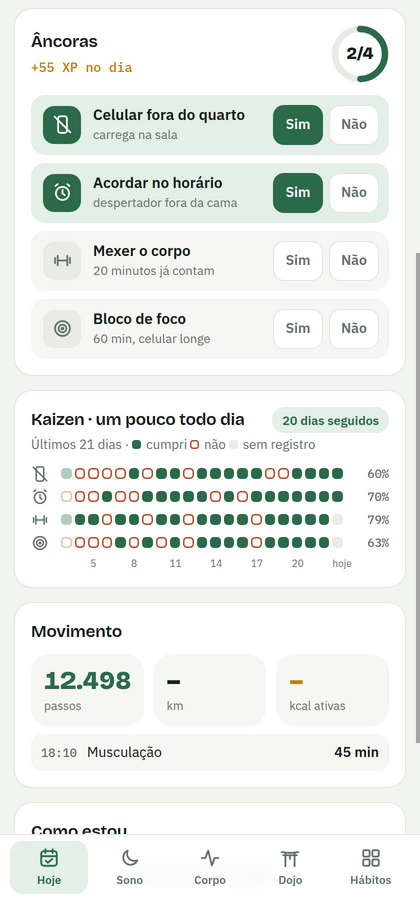

# Kaizen OS

**改善 · um pouco todo dia.** Monitor pessoal de hábitos e saúde, **feito para funcionar junto com o seu agente de IA pessoal** e alimentado pelo seu **relógio ou pulseira inteligente**. Privado, self-hosted, instalável no celular.

<p>
  
  
  
</p>

<sub>Capturas com dados de demonstração.</sub>

## 🤖 Feito para agentes pessoais

O Kaizen OS nasceu para ser operado **a dois: você e o seu agente** ([Hermes Agent](https://github.com/NousResearch/hermes-agent), Claude Code, OpenClaw, Codex ou qualquer agente com acesso a terminal).

- **Registre conversando.** "Fui à academia, 40 min" no Telegram/WhatsApp → o agente grava com `app.py set hoje academia=sim`. O app no celular atualiza sozinho.
- **Check-in que pergunta só o que falta.** O agente lê o dia (`app.py get hoje`), vê o que você já marcou ou o que o relógio já trouxe, e pergunta apenas o resto. Ex.: às 20h, e depois sem telas.
- **Revisões com dados reais.** Semanal ou mensal, o agente lê o histórico (`resumo`, `export` em CSV) e conduz a conversa: o que graduar, o que ajustar, o que entra na próxima fase.
- **CLI e API JSON** completas: hábitos, fases, check-ins, sono, passos e treinos. Tudo documentado em **[`AGENTE.md`](AGENTE.md)**, pronto para virar skill/instrução do seu agente.
- **E quem monta é a IA também:** o **[`GUIA-PARA-IA.md`](GUIA-PARA-IA.md)** conduz a instalação inteira passo a passo.

## ⌚ Conecta com seu relógio ou pulseira inteligente

Sono, passos, treinos e sinais vitais entram **sozinhos**, sem digitar nada:

| O que chega | Onde aparece |
|---|---|
| **Sono:** horário de dormir e acordar, horas dormidas, fases (profundo, REM, leve, acordado) | Card da noite, gráfico "Quando eu durmo", regularidade, noites antes da meia-noite |
| **Passos, distância e calorias ativas** | Aba Corpo, XP por dia ativo |
| **Treinos** (musculação, caminhada, corrida…) com duração | Dica automática na âncora de treino, lista de treinos |
| **Frequência cardíaca e SpO₂** | Treinos detectados pela FC, oxigenação da noite |

Funciona com qualquer relógio/pulseira cujo app escreva no **Health Connect** do Android: **Xiaomi Smart Band** (Mi Fitness), **Samsung Galaxy Watch** (Samsung Health), **Pixel Watch e Fitbit**, **Garmin**, **Amazfit** (Zepp) e outros. O caminho é:

```
relógio → app do fabricante → Health Connect → HC Webhook (app gratuito, código aberto) → seu Kaizen OS
```

Sem relógio (ou no iPhone), tudo funciona com o check-in manual.

## A ideia

- **Âncoras:** poucos hábitos pequenos e concretos ("20 minutos já contam"). Você escolhe quantos; uma lista enxuta é mais fácil de manter (se quiser, trave um limite com `config limite N`).
- **Graduação:** quando um hábito fica no automático (85% em 21 dias), ele **gradua** 🎓, sai do check-in diário e abre espaço para o próximo. O histórico fica.
- **Fases:** blocos de 2 a 3 semanas. No fim de cada uma, você (e seu agente) revê o que graduar e o que entra.
- **Kaizen:** o mapa dos últimos 21 dias na tela inicial. Um pouco todo dia é o superpoder.
- **Recaída é dado, não sentença:** falhar um dia nunca tira XP, recorde nem conquista.

## O que tem no app

- **Hoje:** check-in Sim/Não, anel de progresso, a noite de sono, passos, treinos, energia, ansiedade e uma nota.
- **Sono:** quando você dorme e acorda, noite a noite, regularidade e fases.
- **Corpo:** passos, treinos e frequência cardíaca.
- **Dojo:** XP, níveis (de Rōnin a Mestre dos Cinco Anéis), sequências, conquistas com som, vibração e confete, e a gestão dos hábitos (criar, graduar, pausar).
- **PWA:** instala como app no Android, iPhone e computador; abre offline com o último estado.

## Como montar (com uma IA guiando)

1. Baixe este repositório (**Code → Download ZIP**) ou clone.
2. Envie o **[`GUIA-PARA-IA.md`](GUIA-PARA-IA.md)** ao seu assistente de IA. Se ele acessa a internet, basta colar o link deste repositório.
3. Diga: *"Leia o GUIA-PARA-IA.md e me ajude a montar o meu Kaizen OS, um passo de cada vez."*

A IA pergunta seu sistema, celular, relógio e hábitos, e conduz cada etapa com um teste de verificação. Tempo estimado: 30 a 60 minutos.

## Requisitos

- Um computador que fique ligado (PC, notebook, mini-PC, Raspberry Pi ou VPS) com **Python 3.9+**. Sem dependências externas; banco SQLite local. Se o seu agente já roda num servidor, use o mesmo.
- **[Tailscale](https://tailscale.com)** (grátis) no computador e no celular, para acessar com HTTPS sem expor nada na internet.
- Opcional: relógio/pulseira no Android + [HC Webhook](https://github.com/mcnaveen/health-connect-webhook).

## Início rápido (para quem já sabe)

```bash
cp app/seed.example.json app/seed.json          # edite: nome, hábitos, fase
export ANCORAS_TOKEN="$(python3 -c 'import secrets;print(secrets.token_urlsafe(32))')"
python3 app/app.py serve --host 127.0.0.1 --port 8787
# abra http://localhost:8787/?k=$ANCORAS_TOKEN uma vez (grava um cookie de 1 ano)
```

Serviço permanente: `deploy/kaizen-os.service` (systemd) ou `deploy/docker-compose.yml`.

## Estrutura

```
GUIA-PARA-IA.md        roteiro para a IA conduzir a instalação
AGENTE.md              instruções para o seu agente pessoal operar o Kaizen OS
app/app.py             servidor HTTP + CLI (hábitos, fases, check-ins, export CSV)
app/saude.py           ingestão do Health Connect e resumos diários
app/index.html         interface (PWA responsiva, claro/escuro)
app/static/jogo.js     XP, níveis, conquistas, sons (Web Audio) e confete
app/seed.example.json  modelo de hábitos e fase
deploy/                systemd e Docker
```

## Privacidade

Seus dados ficam só no seu computador (`kaizen.db`). Nenhuma telemetria, nenhuma conta. O token de acesso fica num arquivo local; o token do webhook do relógio só consegue **gravar** dados de saúde, nunca ler.

## Licença

[MIT](LICENSE).
